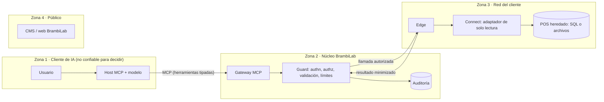

# Arquitectura
Estado: propuesta (2026-11-25). Nada de esto está implementado. Las tecnologías mencionadas son candidatas pendientes de ADR.

## Piezas y repositorios
La plataforma de integración es independiente de la web pública:

| Pieza | Qué es | Dónde vive | Estado |
|---|---|---|---|
| **CMS público** | Web y panel de BrambiLab ([platform/](../../platform/README.md), [web-v1](../../docs/architecture/web-v1.md)) | Este repositorio (público, Apache-2.0) | Desplegada en producción con pendientes ([#43](https://github.com/Codelab-ai-dev/brambiLab/issues/43)) |
| **Núcleo comercial** | Gateway, Connect, Guard, Insights y, más adelante, Studio | Repositorio privado `brambilab-core` (nombre provisional), si se aprueba [ADR-011](../../docs/architecture/ADR-011-evolucion-plataforma.md) | No existe |
| **Ejecución local (Edge)** | Proceso instalado en la red del cliente que aloja los adaptadores | Mismo repositorio que el núcleo | No existe |
| **Laboratorio POS** | Datos sintéticos, reportes de referencia y batería de validación | Por decidir en ADR-011: este repositorio si no contiene nada propietario, o el privado | No existe |

La web y la plataforma **no comparten base de datos ni credenciales**. La base de la plataforma (PostgreSQL es la candidata) será independiente de la del CMS.

## Límites de confianza

| Límite | Qué se confía y qué no |
|---|---|
| Z1 → Z2 | El modelo no es confiable: sus parámetros se validan y su identidad se autentica. Nunca decide permisos ni consultas. |
| Z2 → Z3 | Edge solo acepta llamadas firmadas o autenticadas del núcleo, y solo de herramientas que tenga configuradas localmente. Edge abre la conexión hacia fuera; la red del cliente no expone puertos de entrada. |
| Z3 → POS | El adaptador usa credenciales de solo lectura y consultas predefinidas. El POS no se modifica. |
| Z4 | La web pública no tiene acceso a Z2 ni a Z3, ni comparte con ellas secretos o datos. |

En el **MVP** las zonas 2 y 3 se ejecutan juntas en la máquina del laboratorio, sin red externa. Los límites se mantienen igual en el código para no tener que rediseñarlos al separarlos.

## Flujo de una llamada
1. El usuario pregunta en su cliente de IA. El modelo elige una herramienta del catálogo (p. ej. `sales_by_product`) y sus parámetros.
2. El Gateway autentica al cliente MCP y resuelve su identidad.
3. Guard valida los parámetros contra el esquema, comprueba la autorización (identidad × herramienta × alcance) y los límites. Si algo falla, devuelve un error tipado y lo audita; no se toca el origen.
4. La llamada autorizada llega a Edge (en el MVP, en el mismo proceso). Edge comprueba que la herramienta existe en su configuración local.
5. El adaptador ejecuta la consulta predefinida con parámetros enlazados, con un tiempo y un número de filas máximos.
6. El resultado se normaliza al esquema de salida y se minimiza (solo los campos declarados).
7. Se escribe el registro de auditoría y la respuesta vuelve al cliente.

## Capacidades y procesos
Las capacidades de [vision.md](vision.md#capacidades-evolutivas) no se corresponden con microservicios. Despliegue propuesto por etapas:

- **MVP:** un único proceso local (Gateway + Guard + Connect + auditoría a archivo o base local).
- **Gateway de solo lectura:** Gateway separado de Edge cuando haga falta servir a más de un cliente o una ubicación.
- **Edge y producción:** Edge como servicio instalable en la red del cliente, con conexión saliente al Gateway.
- **Studio:** interfaz de administración sobre la API del núcleo.

Separar en más servicios solo se justifica con una necesidad medida: escalado, aislamiento o ciclos de despliegue distintos.

## Seguridad desde el primer incremento
- Solo lectura en tres capas (credenciales, modo de conexión y catálogo), según el [RNF-01](requirements.md#6-requisitos-no-funcionales-y-de-seguridad).
- Sin SQL generado por el modelo y sin escrituras.
- Autorización por lista de permitidos, denegando por defecto.
- Secretos fuera del repositorio y de los registros.
- Auditoría de solo anexión desde el primer día.
- Datos sintéticos en todo lo que esté en este repositorio.

## Decisiones pendientes
ADRs **propuestos**, sin número reservado hasta que se redacten ([convenciones](../../docs/conventions.md)). Ninguno está tomado.

| ADR propuesto | Pregunta | Candidato inicial | Validar antes de aceptar |
|---|---|---|---|
| Stack | Lenguajes y base de datos | Go para Edge y administración; TypeScript para el Gateway; React para Studio; PostgreSQL independiente | Madurez del SDK MCP en cada lenguaje; binario único de Edge en Windows y Linux (los POS heredados suelen correr en Windows: hipótesis que hay que confirmar); coste de mantener dos lenguajes frente a uno; reutilizar la experiencia de la web (Go, React) |
| Contrato de conectores | Interfaz común de los adaptadores: descripción de herramientas, esquemas, errores, límites y versiones | Herramientas declarativas (consulta parametrizada + esquemas) con un adaptador SQL o CSV como referencia | Que el laboratorio POS se exprese entero con el contrato; prueba estática de que no hay escrituras |
| Transporte MCP | Cómo se conecta el cliente: stdio en local o HTTP en remoto | stdio en el MVP; HTTP con autenticación en el Gateway remoto | Versión vigente de la especificación MCP y soporte en los clientes objetivo |
| Identidad y aislamiento | Cómo se identifican clientes y usuarios, y cómo se aíslan datos y configuración entre empresas | Un inquilino por empresa, con identidades por usuario y por Edge | Modelo de amenazas; aislamiento en la base y en los registros |
| Ejecución local (Edge) | Instalación, actualización, conexión saliente, custodia de secretos en la red del cliente | Binario firmado con conexión saliente y configuración local | Requisitos de red de un cliente piloto; actualización y reversión |
